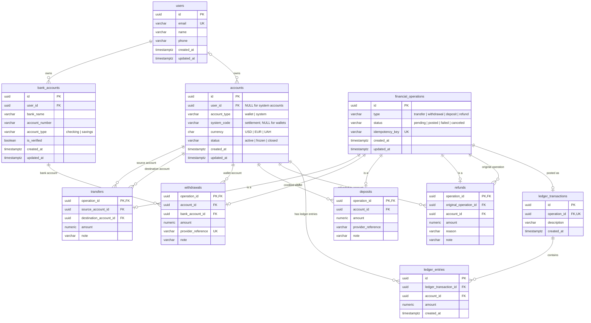

# Wallet API — Database Design

## 1. Overview

**Database:** PostgreSQL  
**Architecture:** Relational, normalized schema with an append-only financial ledger  
**Persistence:** Raw SQL via `node-postgres (pg)`  
**Schema management:** Versioned SQL migrations

The database separates business operations from accounting records. Financial operations describe *what happened*; ledger entries record *how account balances changed*.

## 2. Data Model

| Domain | Tables | Responsibility |
|---|---|---|
| Identity | `users` | User profiles |
| Accounts | `accounts`, `bank_accounts` | Customer wallets, system accounts, external bank references |
| Operations | `financial_operations` | Operation identity, type, status, idempotency |
| Subtypes | `transfers`, `deposits`, `withdrawals`, `refunds` | Operation-specific data |
| Ledger | `ledger_transactions`, `ledger_entries` | Accounting postings and balance history |

### ER Diagram



### Relationships

- `users` → `accounts`: 1:N; `user_id` nullable only for system accounts.
- `users` → `bank_accounts`: 1:N.
- `financial_operations` → operation subtype: 1:0..1 per subtype, using a shared PK/FK.
- `financial_operations` → `ledger_transactions`: 1:0..1, enforced by `UNIQUE(operation_id)`.
- `ledger_transactions` → `ledger_entries`: 1:N.
- `accounts` → `ledger_entries`: 1:N.
- `refunds.original_operation_id` → `financial_operations.id`: N:1.

Each financial operation must have exactly one subtype matching its `type`. This is a cross-table invariant, not guaranteed by the individual foreign keys.

The diagram shows only real foreign keys. `financial_operations` has no `account_id`: accounts are linked through the subtype tables and through `ledger_entries`.

## 3. Key Design Decisions

### 3.1 Operation Supertype/Subtype Model

Shared attributes (`type`, `status`, `idempotency_key`, timestamps) reside in `financial_operations`.

Operation-specific attributes reside in subtype tables.

**Benefits:** Avoids unrelated nullable columns, centralizes lifecycle management, and preserves referential integrity.

**Trade-off:** Requires joins and explicit subtype consistency enforcement.

### 3.2 Ledger as Source of Truth

Balances are derived from immutable ledger entries.

```sql
SELECT
    a.id,
    a.currency,
    COALESCE(SUM(le.amount), 0) AS balance
FROM accounts a
LEFT JOIN ledger_entries le
    ON le.account_id = a.id
WHERE a.id = $1
GROUP BY a.id;
```

- Positive amounts increase account balances.
- Negative amounts decrease balances.
- Monetary values use `NUMERIC`, never floating-point types.
- Posted ledger entries are not updated or deleted.
- Corrections create compensating entries.

**Trade-off:** Aggregation cost grows with ledger history. A transactionally maintained balance projection is a possible future optimization.

### 3.3 Customer and System Accounts

`accounts.account_type` distinguishes:

- `wallet`: Customer-owned account; `user_id IS NOT NULL`, `system_code IS NULL`.
- `system`: Internal accounting account; `user_id IS NULL`, `system_code` names its role.

Existing accounts became wallets when `account_type` was added (migration 0011).

**Settlement accounts** are the system accounts with `system_code = 'settlement'`. There is exactly one per supported currency (USD, EUR, UAH), guaranteed by `UNIQUE (system_code, currency)`. They represent the outside world, so they are the counterparty for simulated deposits and withdrawals. Services look one up by role and currency:

```sql
SELECT id
FROM accounts
WHERE system_code = 'settlement'
  AND currency = $1;
```

A settlement account's balance is the negative of everything customers hold in that currency. For example, when customer wallets hold 8,600 USD in total, the USD settlement account shows `−8600`.

Customer and system accounts share the ledger infrastructure but follow different operational rules:

- System accounts are never returned by customer-facing account endpoints.
- Transfers, withdrawals, deposits and refunds name customer wallets in their subtype tables. Only ledger entries reference system accounts.
- System accounts have no overdraft limit; their balance is expected to be negative.

New system roles (e.g. a fee account) need a migration that extends `chk_accounts_system_code`.

### 3.4 Financial Posting Invariants

For every posted ledger transaction:

1. All entries must reference accounts with the same currency.
2. The sum of signed entry amounts must equal zero.
3. A financial operation must not be posted more than once.
4. Posting and operation status changes must commit atomically.

```text
SUM(ledger_entries.amount) = 0
```

For example, a transfer of 100 USD produces `−100` on the source account and `+100` on the destination account.

Balance validation must prevent unauthorized overdrafts on customer wallets.

These invariants span several rows, so row-level `CHECK` constraints cannot enforce them. The posting service enforces them, and `database/validation/01_ledger_balance.sql` detects violations in existing data.

### 3.5 Deposits

A deposit simulates money arriving from outside the system, such as a card top-up.

- `financial_operations` row with `type = 'deposit'` holds status and idempotency.
- `deposits` row (`operation_id` is both PK and FK) holds the credited wallet, amount, optional `provider_reference` and note.
- When posted, a `ledger_transactions` row and two `ledger_entries` move the amount from the settlement account of the wallet's currency to the wallet.

`deposits.account_id` must be a customer wallet. The schema cannot express this through a plain foreign key, so the deposit service validates it inside the posting transaction.

### 3.6 Accounting Rules

Ledger movements for each operation type. Amounts are signed: positive increases a balance.

**Deposit: 500 USD**

| Account | Amount |
|---|---:|
| Customer wallet | +500 |
| USD settlement | −500 |

**Transfer: 100 USD**

| Account | Amount |
|---|---:|
| Source wallet | −100 |
| Destination wallet | +100 |

**Withdrawal: 50 USD**

| Account | Amount |
|---|---:|
| Customer wallet | −50 |
| USD settlement | +50 |

**Refund**

A refund posts compensating entries that reverse all or part of the original operation's effect. It is a new operation with its own ledger transaction; the original entries are never changed. One operation can have several partial refunds, so the service must keep their total within the original amount.

| Refunded operation | Refund entries (amount X) |
|---|---|
| Transfer | Destination wallet −X, source wallet +X |
| Withdrawal (e.g. payout returned by the bank) | Settlement account −X, customer wallet +X |
| Deposit (e.g. card chargeback) | Customer wallet −X, settlement account +X |

## 4. Integrity and Constraints

| Invariant | Enforcement |
|---|---|
| Unique user email | `UNIQUE` constraint/index |
| Valid account types | `chk_accounts_account_type`: `wallet`, `system` |
| Valid account ownership | FK + `chk_accounts_ownership`: wallets have a user, system accounts don't |
| System accounts have a role | `chk_accounts_system_code`: `settlement` for system accounts, `NULL` for wallets |
| One settlement account per currency | `uq_accounts_system_code_currency` |
| One wallet per user and currency | `uq_accounts_user_currency` |
| Supported currencies | `chk_accounts_currency`: `USD`, `EUR`, `UAH` |
| Positive operation amounts | `CHECK(amount > 0)` on every subtype table |
| Non-zero ledger entries | `CHECK(amount <> 0)` |
| Different transfer accounts | `CHECK(source_account_id <> destination_account_id)` |
| Valid operation types | `chk_financial_operations_type`: `transfer`, `withdrawal`, `refund`, `deposit` |
| Valid statuses | `accounts_status_check`, `chk_financial_operations_status` |
| One ledger transaction per operation | `UNIQUE(operation_id)` |
| Unique payout reference | `uq_withdrawals_provider_reference` |
| Referential integrity | Foreign keys |
| Subtype matches operation type | Transactional logic |
| Subtype accounts are customer wallets | Transactional logic |
| Balanced, single-currency ledger postings | Transactional validation |
| Immutable ledger entries and currency | Application rule: no `UPDATE`/`DELETE` on ledger tables, no `UPDATE` of `accounts.currency` |
| No duplicate financial execution | Idempotency handling |
| No customer overspending | Locks + transactional balance checks |

Cross-row invariants cannot be enforced using ordinary row-level `CHECK` constraints alone.

`database/validation/` holds SQL scripts that check these rules against a seeded database. `04_account_types_and_deposits.sql` tries invalid inserts and checks that the expected constraint rejects each one. It runs in a transaction that is rolled back.

## 5. Transaction and Concurrency Strategy

Financial postings execute inside a single PostgreSQL transaction using one `PoolClient`.

```text
BEGIN
  → Lock affected accounts (deterministic order)
  → Validate account status and available funds
  → Create financial operation and subtype
  → Create ledger transaction and balanced entries
  → Mark operation as posted
COMMIT / ROLLBACK
```

**Isolation:** `READ COMMITTED` with explicit row-level locks.

All balance-changing workflows must follow the same locking protocol.

Concurrency requirements:

- Prevent double spending.
- Acquire multiple account locks consistently to reduce deadlocks.
- Retry appropriate transient failures.
- Never perform financial posting across independent database transactions.

## 6. Idempotency

`financial_operations.idempotency_key` has a unique constraint.

Required behavior:

- New key → process operation.
- Existing key + identical request → return existing result.
- Existing key + different request → reject with conflict.
- Concurrent duplicate requests → at most one financial operation is executed.

A unique key alone does not validate request equivalence; application logic must enforce it.

## 7. Indexing

| Table | Index | Purpose |
|---|---|---|
| `accounts` | `(user_id)` | User account lookup |
| `bank_accounts` | `(user_id)` | Linked bank accounts |
| `transfers` | `(source_account_id)` | Outgoing transfers |
| `transfers` | `(destination_account_id)` | Incoming transfers |
| `withdrawals` | `(account_id)` | Withdrawal history |
| `deposits` | `(account_id)` | Deposit history |
| `refunds` | `(original_operation_id)` | Refund lookup |
| `ledger_entries` | `(account_id)` | Balance calculation |
| `ledger_entries` | `(ledger_transaction_id)` | Posting reconstruction |
| `financial_operations` | `UNIQUE(idempotency_key)` | Idempotency |
| `ledger_transactions` | `UNIQUE(operation_id)` | Prevent duplicate posting |

Primary keys already have indexes. So do unique constraints: `UNIQUE(idempotency_key)`, `UNIQUE(operation_id)`, `uq_accounts_user_currency` (which also serves lookups by `user_id`) and `uq_accounts_system_code_currency` (settlement lookup). The other indexes in this table are planned but not created yet. Additional indexes should be justified by actual query workloads and verified with `EXPLAIN (ANALYZE, BUFFERS)`.

PostgreSQL does not automatically index referencing foreign-key columns.

## 8. Design Trade-offs

| Decision | Trade-off |
|---|---|
| Raw SQL instead of ORM | More control; more manual mapping |
| Normalized operation subtypes | Fewer nullable fields; additional joins |
| Derived balances | Auditable source of truth; more expensive reads |
| Shared wallet/system account table | Simpler ledger references; stricter validation required |
| Synchronous PostgreSQL transactions | Strong consistency; increased contention |
| Signed-amount ledger | Simple wallet accounting; not a full general ledger |

## 9. Business Rules for the NestJS Services

The schema enforces single-row rules. The posting services still need to enforce these, inside the posting transaction:

- Subtype accounts (transfer source and destination, deposit, withdrawal and refund accounts) are `wallet` accounts with status `active`.
- The operation's `type` matches the subtype row it gets, and every operation gets exactly one subtype row.
- All ledger entries of a posting use accounts of one currency, sum to zero, and use the settlement account of that currency as the external counterparty.
- Customer wallets cannot go below zero; system accounts can.
- An operation is posted at most once, and its ledger rows and its `status = 'posted'` update commit together.
- Partial refunds never exceed the amount of the original operation in total.
- Ledger entries and `accounts.currency` are never updated; corrections are new compensating operations.
- Idempotency keys follow the rules in section 6.

## 10. Scope Boundaries

The system supports simulated deposits, transfers, withdrawals, and refunds.

It does not implement real bank settlement, foreign exchange, a full general-ledger chart of accounts, or regulatory accounting.

The database design prioritizes **correctness, explicit relationships, transactional consistency, and auditability** over premature optimization.
